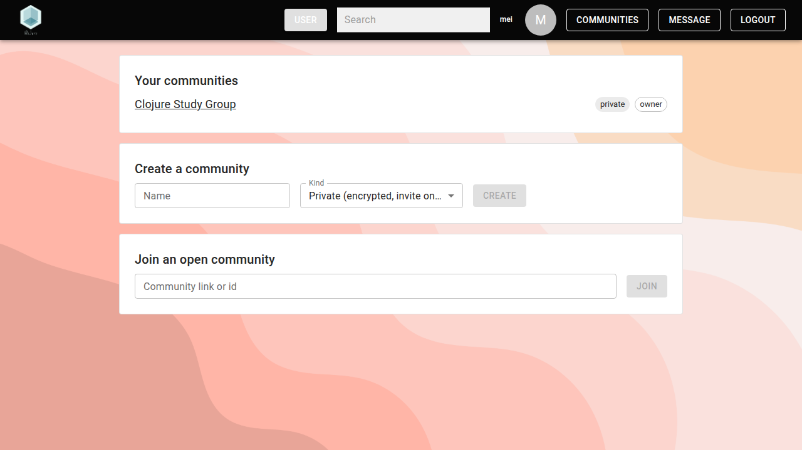
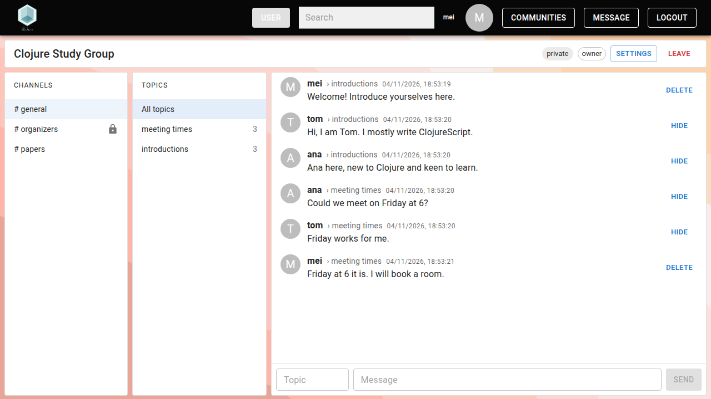

{:title "Communities"
 :description "WeJure's communities: private and open, channels and topics, roles and owner votes, and how they work with no server in charge."
 :layout :page
 :toc :ul
 :page-index 4
 :navbar? true}

Communities are WeJure's group spaces, laid out like [Zulip](https://zulip.com/): a community has channels, and the messages in a channel are grouped by topic. No relay is in charge of a community: each member's client works out from signed records who belongs and who may do what.

## Private and open communities

- **Private** communities are encrypted and invite only. Relays see neither the community nor who writes nor the topics.
- **Open** communities are public: anyone with the link can join, unless an admin switches joining to invitation only. They can still have private channels, which are encrypted.

## Create a community

Click **Communities** in the top bar. Under **Create a community**, enter a name, choose **Private** or **Open**, and click **Create**. You become the owner, and the community starts with one channel, `general`.

## Invite and join

- **Adding people:** admins and owners open **Settings**, enter a username under **Add by username**, choose a role and click **Add**. The person then finds an invitation on their Communities page and clicks **Accept**. If several accounts share that username, WeJure refuses to guess.
- **Joining an open community:** its members can **Copy link** at the top of the community. Others paste the link under **Join an open community** and click **Join**, or open it and click **Join** there.

Your list of communities is saved, encrypted to you, with your account, so it comes back when you log in on another device.

## Channels and topics

The community page has three columns: the channels, the topics of the selected channel, and its messages. A lock marks a private channel.

To write, either select a topic, or, with **All topics** selected, type a new topic name in the **Topic** box. Then type your message and press Enter or click **Send**. A channel opens at its newest messages; scroll up or click **Load older messages** for older ones. A **+** after a topic's count means the channel has older messages not loaded yet, which may add to it.

Your own messages have a **Delete** button. Moderators and above can **Hide** other people's messages.

Admins and owners create channels in **Settings**, under **Channels**. Each channel has two settings:

- **Who:** everyone in the community, or chosen members (a private channel, with its own key).
- **History:** whether newcomers see the past, or only what is written after they join.

**Archive** removes a channel from the list.

## Roles

| Role | Can |
|------|-----|
| member | read and write in their channels, delete their own messages, leave |
| moderator | also hide messages, and remove members |
| admin | also add people, make members moderators and back, create and archive channels, change the name, description and joining |
| owner | also make admins, and propose changes to the owners |

Moderators, admins and owners can **Remove** only people ranked below them. In open communities, **Ban** also keeps the person from joining again.

**Owner votes.** Making someone an owner, or demoting or removing an owner, needs a majority of the owners: such a change shows up under **Owner votes** in Settings, and takes effect once more than half of the owners have approved it (the owner who proposed it counts; the others click **Approve**). With three or more owners, one lost or rogue owner can neither take the community over nor freeze it. The last owner cannot leave.

## How communities work

- **Operations.** Every change, such as adding a member or creating a channel, is an operation: an event signed by whoever makes it, which names the latest operations its author had seen. The operations form a graph, like git commits, and every member's client computes the community's state from it with the same rules. No relay has to put them in order or enforce anything, and an operation by someone without the right role simply does not count.
- **Keys.** In a private community, the log of operations and each channel have their own chain of keys; in an open community, only the private channels do. Each key reaches the members in an encrypted message (NIP-59), so all their devices can read it. When someone leaves or is removed, a new key replaces the old one, so they cannot read what comes after. New members get the keys for the past, unless a channel shows newcomers only what comes after they join.
- **No backdating.** A removed member still holds the old keys. To keep them from slipping in messages dated as if from before, the removal records their latest messages, and later ones do not count.
- **Checkpoints.** The owners' clients regularly sign a snapshot of the community's state, which counts once a majority of the owners approved it. A new device starts from the latest snapshot instead of replaying every operation: in WeJure's benchmark, it receives 8 events instead of 334.

Why not an existing standard? NIP-29 groups live on one relay, which enforces membership: if it goes down, the group goes with it. MLS (Marmot, on Nostr) treats each device as a member, so a new phone cannot read what was sent before it joined, and needs all members to apply changes in one agreed order. The full design, with its known limits, is in [docs/COMMUNITIES.md](https://github.com/clojure-finance/WeJure/blob/main/docs/COMMUNITIES.md).
