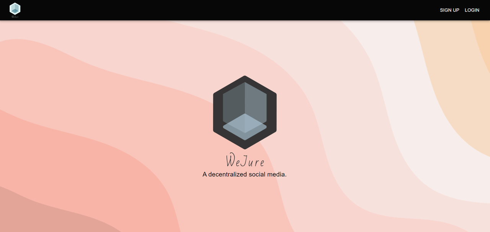

{:title "Getting Started"
 :layout :page
 :toc :ul
 :page-index 3
 :navbar? true}

WeJure runs on your own machine: an IPFS node stores the images, a small relay server syncs the data, and the app itself is served at [http://localhost:8020](http://localhost:8020). Setup scripts for macOS, Linux and Windows do most of the work.

## Get the code

```bash
git clone https://github.com/clojure-finance/WeJure.git
cd WeJure
```

## First-time setup

The setup scripts install Node.js, Yarn and IPFS, initialize IPFS and download the dependencies. Run the one for your system once.

**macOS**

```bash
./WejureStartup.sh
```

**Linux**

```bash
./setup_wejure_linux.sh
```

**Windows** (PowerShell)

```powershell
Set-ExecutionPolicy RemoteSigned -Scope Process
.\WeJureWinStart.ps1
```

The scripts do not install Java. Check that a Java SDK 21 or newer is installed:

```bash
java -version
```

## Run WeJure

**macOS and Linux**

```bash
./WejureRun.sh
```

**Windows** (PowerShell)

```powershell
.\WeJureWinRun.ps1
```

Once the build has finished, open [http://localhost:8020](http://localhost:8020). [Using WeJure](../usage/) explains what you can do there.



The run scripts start three processes. To start them by hand instead, run each in its own terminal:

1. the IPFS daemon: `ipfs daemon`
2. the GunDB relay, which syncs data between browsers: `cd src/wejure/js && node relay`
3. the development server: `yarn dev`

## Configure IPFS by hand

The setup scripts already do this. If you set up IPFS yourself, allow the WeJure page to call the IPFS API:

```bash
ipfs config --json API.HTTPHeaders.Access-Control-Allow-Origin \
  '["http://localhost:8020", "http://localhost:5001", "https://webui.ipfs.io"]'
ipfs config --json API.HTTPHeaders.Access-Control-Allow-Methods '["PUT", "POST"]'
```

WeJure uploads images through the IPFS API on port 5001 and loads them from the gateway on port 8080. If the API listens elsewhere, run:

```bash
ipfs config Addresses.API /ip4/127.0.0.1/tcp/5001
```

## Use WeJure on more than one machine

Users only see each other's data when their browsers reach a common relay. To connect several machines, run the relay on a host they can all reach (for example `HOST=0.0.0.0 node relay`) and add its URL to `peers` in `src/wejure/js/db.js`.

## Delete all data

1. Clear the site data (local storage) in every browser that opened WeJure.
2. Stop the relay and run `./remove_local_gun.sh`, which deletes `src/wejure/js/radata`.

## For developers

### Production build

```bash
yarn release
```

This writes an optimized `public/js/main.js`. Serve the `public/` folder with any web server that falls back to `index.html` for unknown paths, since WeJure uses real URLs such as `/home`. The IPFS daemon and the relay must still be running.

### End-to-end tests

```bash
npx playwright install chromium   # once, to install the test browser
yarn test:e2e
```

The test builds the release version and walks through every page with two users. It starts its own relay (with empty data), an IPFS stand-in and a web server on the ports WeJure uses (8001, 5001, 8080 and 8020), so stop any IPFS daemon, relay or development server first.

### Data model and code layout

The [WeJure README](https://github.com/clojure-finance/WeJure#readme) documents where each kind of data is stored in GunDB and how the code is organized.
