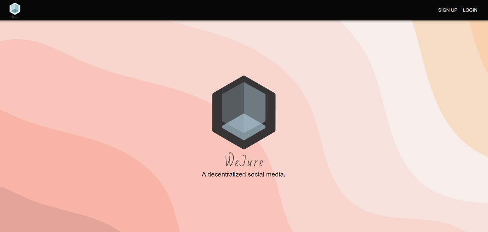

{:title "Getting Started"
 :description "Build and run WeJure on your own machine, use other relays and media servers, and run its tests."
 :layout :page
 :toc :ul
 :page-index 2
 :navbar? true}

WeJure runs on your own machine as a single process: a small Node.js server serves the app and runs a Nostr relay and a Blossom media server next to it, all at [http://localhost:8020](http://localhost:8020).

## Requirements

- [Node.js](https://nodejs.org/) 22.13 or newer
- [Java](https://adoptium.net/) 21 or newer, to build the ClojureScript

Check both with:

```bash
node --version
java -version
```

## Get the code

```bash
git clone https://github.com/clojure-finance/WeJure.git
cd WeJure
```

## Build and run

```bash
npm install
npm run release   # builds public/js/main.js
npm start         # http://localhost:8020
```

Open [http://localhost:8020](http://localhost:8020). [Using WeJure](../usage/) explains what you can do there.



The server keeps its data in `data/`. Its options:

```bash
node server/index.js [--port 8020] [--host 127.0.0.1] [--data data] [--public public]
```

The `PORT` and `HOST` environment variables work too.

## Development mode

```bash
npm run dev
```

This runs the shadow-cljs watch build, which updates the open page as you edit the ClojureScript (hot reload), together with the server, also at [http://localhost:8020](http://localhost:8020).

## Use other relays and media servers

By default the app uses the relay and media server of the server it came from. To spread the data across independent servers, list them in `public/config.js`; no rebuild is needed:

```js
window.WEJURE_CONFIG = {
    relays: ["wss://relay-one.example", "wss://relay-two.example"],
    mediaServers: ["https://media-one.example", "https://media-two.example"],
};
```

Any standard Nostr relay and Blossom server works. Each account also saves its lists of relays and media servers (NIP-65, BUD-03), so others can find its data. With more than one relay, each client copies its user's own events, and the messages addressed to them, to any relay that misses them, once per session, so a relay that was down catches up.

## Use WeJure on more than one machine

To reach the server from other machines, start it with `--host 0.0.0.0` behind a TLS proxy, so the relay is reachable as `wss://`. Before you open it to the public, note that its media server accepts uploads of up to 100 MB from any account, with no quota. Its relay closes connections that send a message over 256 KB and allows 100 subscriptions per connection.

## Delete all data

Stop the server and delete its `data/` directory. Logins live only in the browser tab, and each browser's cache of an account is deleted on logout, or with the site's stored data.

## For developers

### Tests

```bash
npm test
```

runs the Node tests (about 1 minute) against several real server instances, which the tests crash on purpose, plus a relay and a media server that lie. They cover accounts, the feed, messages, media, redundancy, live updates, the device cache, fetching only what is new, and the community rules, including attacks on them.

```bash
npx playwright install chromium   # once, to install the test browser
npm run test:e2e
```

builds the release version and runs [Playwright](https://playwright.dev/) through every page with several users, communities included (about 1 minute). It fails on any console error or warning. It starts its own server with empty data on port 8020, so stop any WeJure server there first.

```bash
npm run bench
```

times loading, reading and sending in a community, and counts the events the relays send for each.

### Code layout

- `src/wejure/`: the ClojureScript pages
- `packages/wejure-nostr/`: the data layer, a local npm package in JavaScript
- `server/`: the server (app, relay and media server on one port)
- `public/config.js`: the relays and media servers of the site

The [WeJure README](https://github.com/clojure-finance/WeJure#readme) describes the data model, the security model and every module.
