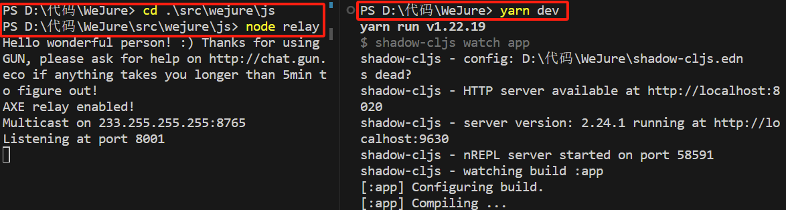
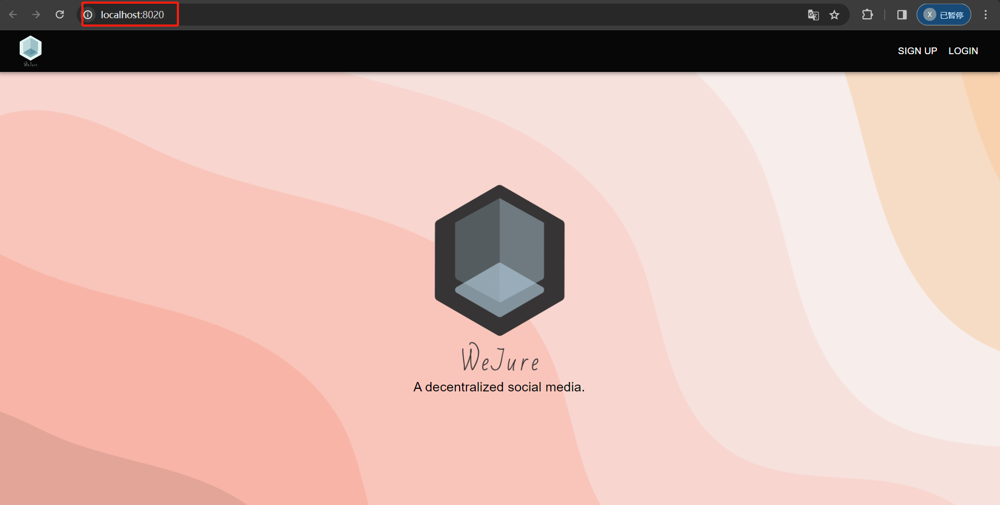

{:title "Step by Step Guide"
 :layout :page
 :toc :ul
 :page-index 3
 :navbar? true}

### Get the code

```
git clone https://github.com/clojure-finance/WeJure.git
cd WeJure
```

### First-time setup

The setup scripts install the requirements (Node.js, Yarn, IPFS), initialize IPFS and download the dependencies.

**macOS**
```
./WejureStartup.sh
```

**Linux**
```
./setup_wejure_linux.sh
```

**Windows** (PowerShell)
```
Set-ExecutionPolicy RemoteSigned -Scope Process
.\WeJureWinStart.ps1
```

The scripts do not install Java. Check that a Java SDK 21 or newer is installed:
```
java -version
```

### Configure IPFS by hand (optional)

The setup scripts already do this. If you set up IPFS yourself, allow the WeJure page to call the IPFS API:
```
ipfs config --json API.HTTPHeaders.Access-Control-Allow-Origin '["http://localhost:8020", "http://localhost:5001", "https://webui.ipfs.io"]'
ipfs config --json API.HTTPHeaders.Access-Control-Allow-Methods '["PUT", "POST"]'
```

WeJure uploads images through the IPFS API on port 5001 and loads them from the gateway on port 8080. If the API listens elsewhere, run:
```
ipfs config Addresses.API /ip4/127.0.0.1/tcp/5001
```

### Run WeJure

**macOS and Linux**
```
./WejureRun.sh
```

**Windows** (PowerShell)
```
.\WeJureWinRun.ps1
```

The scripts start three processes, which can also be started by hand, each in its own terminal:

1. the IPFS daemon: `ipfs daemon`
2. the GunDB relay, which synchronizes data between browsers: `cd src/wejure/js && node relay`
3. the development server: `yarn dev`



### Visit WeJure

Open [http://localhost:8020](http://localhost:8020) once the build has finished.



### Use WeJure on more than one machine

Users only see each other's data when their browsers reach a common relay. To connect several machines, run the relay on a host they can all reach (for example `HOST=0.0.0.0 node relay`) and add its URL to `peers` in `src/wejure/js/db.js`.

### Delete all data

1. Clear the site data (local storage) in every browser that opened WeJure.
2. Stop the relay and run `./remove_local_gun.sh`, which deletes `src/wejure/js/radata`.
