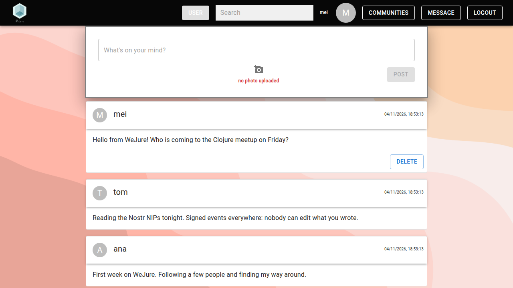

{:title "Using WeJure"
 :description "How to sign up, post, follow people, search and send encrypted direct messages in WeJure."
 :layout :page
 :toc :ul
 :page-index 3
 :navbar? true}

This page walks through WeJure once it is running at [http://localhost:8020](http://localhost:8020). [Getting Started](../example/) explains how to get there, and [Communities](../communities/) covers the group spaces.

## Sign up and log in

Click **Sign Up** on the start page and fill in:

- a username of 3–20 characters: letters, digits and underscores only
- a password of 8–20 characters, entered twice
- a profile picture, if you like

After signing up, log in with the same username and password. That works from any device that reaches the same relays, since your secret key is stored on them, encrypted with your password. A forgotten password cannot be reset.

You stay logged in in that browser tab, also when you reload it. A new tab needs a new login, and closing the tab logs you out. **Logout** in the top bar logs you out right away and deletes what the browser has cached for your account.

## The top bar

Once logged in, the top bar holds:

- the WeJure logo, which leads back to your feed
- the search box (see [Search](#search))
- your username and profile picture, which lead to your profile
- **Communities**, which opens your communities
- **Message**, which opens your messages (on the messages page it becomes **Main Page**)
- **Logout**

## Feed and posts

Your feed shows your own posts and those of everyone you follow, newest first. New posts appear as they are published, and **Load more** at the bottom brings older ones.

To post, type in the "What's on your mind?" box, add a picture with the camera button if you like, and click **Post**. A post needs text, a picture or both. A new post shows "Sending…" until a relay has stored it. If no relay does, the post is withdrawn and your text stays in the box, with an error.

Your own posts have a **Delete** button. A deleted post disappears from other users' screens right away, but its picture stays on the media server.

## Profiles

Click a username or profile picture to open that user's profile, with their bio and posts.

- On someone else's profile, **Follow** adds their posts to your feed. Once you follow them, the profile shows **Message** and **Unfollow**.
- On your own profile, **Edit Profile** changes your bio (up to 150 characters).

Usernames are not unique on an open network. Signing up refuses a name that is taken, but two accounts can still claim the same one at the same time. Then `/user/<name>` lists their public keys instead of picking one. The links inside WeJure point to `/user/~<public key>`, which always names exactly one account.

## Search

The button next to the search box switches between **User** and **Post** search; press Enter to search.

- **User** search finds the accounts with exactly that username.
- **Post** search finds the recent posts of the people you follow that contain your text, ignoring case.

## Messages

Click **Message** in the top bar to open your messages. Your contacts are everyone you follow plus everyone who has written to you, with the most recent conversation first. Pick a contact, type, and press Enter or click **Send**. New messages appear as they arrive.

Messages are end-to-end encrypted: only you and your contact can read them, and relays cannot even tell who sent them.

To block someone, open your conversation with them and click **Block User**. They leave your contacts, and their posts no longer show in your feed or in search results. Blocking works on your side only: they are not told, and nobody can see whom you block. It does not unfollow them, and WeJure has no way to unblock yet.

## Limitations

See [Status and limitations](../docs/#status-and-limitations) for what WeJure cannot do yet.
